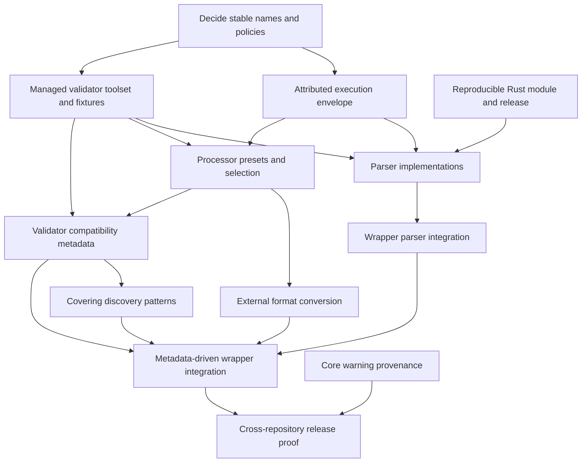

# Schepherd integration

## Goal

Complete the Schepherd, datamitsu and datamitsu-config integration without losing file attribution,
silently skipping validation, or duplicating validator-output parsers in Go and Rust. Preserve the
working offline catalog delivery while adding structured diagnostics and broader validator coverage.

This is an implementation task register, not an instruction to execute every draft recommendation.
Tasks requiring an unresolved product decision remain blocked until that decision is made.

## Recovered intent and evidence

The retained Schepherd worktree `datamitsu-integration-ideas` contains twelve concept documents under
`concepts/`. Its local `.gitignore` contains `*`: these documents are not tracked, so they are not a
durable task system. Preserve that source directory until the relevant requirements are migrated.

The strongest retained design sources are `00-overview.md`, especially its user-decisions section;
`01c-schepherd-validators-via-datamitsu.md`; `01d-schepherd-monorepo-rust.md`;
`02-schepherd-processors-and-json-output.md`; and `03c-schepherd-datamitsu-parser-plugin.md`.
The recovery session and its archived tool results in OpenViking were also inspected. The original
planning session is not directly retrievable through the current session API. Consequently, the
requirements below are recovered design intent, not new approval of every proposed flag or default.

The intended responsibilities were:

- datamitsu discovers files, installs pinned tools, binds exact dependencies, loads WASM parsers and
  presents diagnostics. It remains independent of Schepherd.
- Schepherd resolves schemas and selects configured validator processors. It provides an attributed
  execution envelope, but does not parse validator output by default.
- Sourcemeta `jsonschema` is the primary validator. `check-jsonschema` and AJV cover schemas or formats
  it cannot handle. Projects can override processor selection.
- Conversion belongs to replaceable external tools, initially `yq`, not an embedded conversion stack.
- A Rust WASM module owned and released by Schepherd parses both the Schepherd envelope and direct
  validator output. Proposed keys were `schepherd`, `jsonschema`, `check_jsonschema` and `ajv`.
- Catalog metadata records validator compatibility. Schepherd produces covering discovery globs,
  optionally filtered by validator support. The wrapper should not compile the entire catalog itself
  once equivalent upstream metadata exists.
- A catalog digest is released with datamitsu-config. Prepared schemas and notices travel in OCI
  layers, not inside the JavaScript configuration bundle.

## Verified baseline

| Surface                                          | Current state                                                                                        | Evidence                                                                                            |
| ------------------------------------------------ | ---------------------------------------------------------------------------------------------------- | --------------------------------------------------------------------------------------------------- |
| Schepherd catalog preparation                    | Implemented; full catalog and notices work offline from a relocated read-only copy                   | Schepherd `internal/materialize/`, `internal/cli/materialize_cmd.go`; exercised locally             |
| datamitsu preparation and OCI delivery           | Implemented; preparation identity includes catalog arguments, ready state is restored from the store | `src/datamitsu-config/datamitsu.config.d.ts`, generated Dockerfiles and OCI maps; exercised locally |
| Wrapper runtime integration                      | Pinned Schepherd and Sourcemeta, exact dependency binding, managed configuration, offline lint       | `src/datamitsu-config/apps.ts`, `tools.ts`, `managed-configs/schepherd_toml.ts`                     |
| Catalog selection                                | Generated 1,291 positive globs; 144 schemas excluded after compilation with the pinned validator     | `scripts/pull-schepherd-catalog.ts`, `registries/schepherdCatalog.json`                             |
| Structured diagnostics                           | Missing; the operation has no `outputParser` and forwards anonymous Sourcemeta evaluation JSON       | `src/datamitsu-config/tools.ts`, real CLI output and parser recognition probes                      |
| Schepherd execution report                       | Report version 1 contains task files and exit status, not captured output or diagnostics             | Schepherd `internal/runner/report.go`, `internal/cli/run.go`                                        |
| Rust parser implementation                       | No production Rust crate or WASM module found in main or the retained local branches                 | No Cargo manifests or Rust sources; concept 03c describes only an external research prototype       |
| Additional processors and compatibility metadata | Proposed, not implemented in the inspected client and publisher                                      | Current catalog format is 2; current client explicitly rejects format 3                             |

The installed datamitsu parser pin, npm manifest, OCI manifest, payload hash and loaded WASM version
agree. Neither the latest published stable module nor the latest published unstable module provides a
Schepherd or Sourcemeta parser. This is missing functionality, not a stale parser pin.

## Working rules

- Keep repository changes separate. Do not implement Schepherd behavior in datamitsu-config as a
  workaround for an absent Schepherd contract.
- Preserve the current pinned catalog while changing client protocols; publish readers before new
  catalog writers. Never publish a catalog unreadable by the supported client.
- Keep unrelated existing checks enabled. A failed commit hook is a blocker to resolve, not bypass.
- Use current parser ABI and capability descriptors. The old concepts describe an earlier ABI and
  must not be implemented verbatim.
- For each behavior change, keep a deterministic consumer-visible regression case and exercise the
  actual CLI. Use real validator outputs, not mocks that merely echo the proposed contract.
- No release numbers in evergreen usage prose. Versions belong in executable pins and compatibility
  metadata, or in explicitly dated evidence.

## Dependency graph

Existing preparation/offline delivery is a preserved baseline, not a prerequisite to reimplement.
Task C0 can proceed independently of the main protocol work. Tasks R0, S1 and S2 can proceed in
parallel after the decisions relevant to their public interfaces are settled.

## Task D0: settle durable public contracts

Owner: cross-repository design. Status: open. Dependencies: none.

Record decisions on these unresolved points before publishing the affected interface:

- Processor identity for Sourcemeta: existing `jsonschema`, or a disambiguated `sourcemeta` name.
- AJV frontend: a minimal owned adapter over the maintained AJV library, or an explicitly supported
  existing CLI. The old design recommended an owned adapter; that was not a settled requirement.
- Unsupported schema/format behavior and catalog-only ambiguity: explicit error versus visible skip,
  with project overrides. Never silently choose one ambiguous schema.
- Default validator set and selection order. Separate the desired fallback capability from a decision
  to install and enable every validator for every consuming project.
- Envelope versioning, supported parser ABI/descriptor versions, processor output labels, and shared
  Go/Rust manifest ownership. Reconcile the draft report version with current contracts first.

Acceptance: a concise decision record distinguishes selected behavior from deferred options; later
config, parser and catalog tasks refer to the same names and semantics.

## Task C0: correct known wrapper selection boundaries

Owner: datamitsu-config. Status: open. Dependencies: none; preserve current behavior elsewhere.

- Exclude Cspell JSONC configurations from strict-JSON validation while retaining their YAML forms.
- Resolve the default `manifest.json` and `plugin.yml` collisions without selecting an arbitrary
  schema. Prefer explicit project mappings or omit unsafe automatic selection until Schepherd has a
  supported catalog-only ambiguity policy.
- Align advertised platforms with the mandatory validator dependency. Schepherd's Windows ARM64
  binary currently has no matching Sourcemeta dependency target.

Acceptance: valid commented Cspell config is not rejected; valid extension/plugin manifests do not
fail merely because catalog filenames collide; unsupported dependency targets have an explicit
outcome. Preserve tests and temporary-project smoke cases for these boundaries.

## Task S1: emit an attributed Schepherd execution envelope

Owner: Schepherd. Status: open. Dependencies: D0 for public schema and names.

Add an opt-in machine-output mode that emits one versioned document for the complete run. Include
processor identity/output format, schema identity, exact working directory, original input paths,
actual consumer paths, execution status and bounded captured stdout/stderr for each task. Preserve
plain execution and all nonzero failure outcomes. Report early matching, cache and preparation errors
as structured run-level errors, without pretending a validator ran.

File attribution is a hard prerequisite. A task containing multiple anonymous Sourcemeta results is
not enough. Establish and verify a per-evaluation identity contract, or use one input per consumer
task for formats lacking identity. Do not pair output objects to argv by position: YAML and JSONL can
emit multiple evaluations per file, and malformed inputs can abort before later files are checked.

Acceptance: mixed valid/invalid files, multiple YAML documents, malformed input, ambiguous mappings,
unknown processors, timeout, cancellation, output truncation and offline misses all produce honest,
bounded results. No error can be attributed to a neighboring file or made green by missing output.

## Task S2: manage the validator toolset and capture real fixtures

Owner: Schepherd. Status: open. Dependencies: D0 for stable processor identities and AJV frontend.

Use one pinned toolset for Sourcemeta, check-jsonschema and AJV in tests and publisher probes, installed
through datamitsu. Preserve the publisher's independently pinned bundling recipe when moving its
installer. Capture real valid, invalid, parse-error and compile-error outputs across supported schema
dialects and document formats. Keep direct execution of resolved binaries where exit-code fidelity
requires it; measure the current execution contract instead of copying old assumptions.

Acceptance: no duplicated manual installer path, deterministic tool identity, isolated network-free
fixture execution, and a reproducible validator matrix. An unavailable validator is not recorded as
an unsupported schema. AJV never executes an input document as JavaScript or interprets literal file
paths as globs.

## Task R0: add reproducible Rust parser infrastructure and publication

Owner: Schepherd. Status: open. Dependencies: none for infrastructure; D0 before public metadata.

Create the production parser crate beside the Go code, with one pinned Rust toolchain, locked
minimal dependencies and separated ABI/parse logic. Go-only development must not require Rust.
Integrate package commands with the existing task conventions. Build a module usable by the pinned
datamitsu host, and publish its verified release asset and OCI artifact with machine-readable pins.

Acceptance: native parser tests and actual WASM-host smoke pass; builds from different paths are
byte-identical and contain no developer paths; malformed/deep/truncated input cannot panic or hang;
release metadata identifies the exact payload, ABI, descriptor and supported report versions. Do not
publish an empty module merely to complete infrastructure.

## Task R1: implement the Schepherd-owned validator parser module

Owner: Schepherd. Status: open. Dependencies: R0, S1 and S2.

Implement the Schepherd envelope parser and direct parser entrypoints for the selected validators.
Share validator parsing logic rather than implementing a second copy in the Go client or the core.
Recognize all relevant output documents, suppress successful evaluations and annotations, retain
meaningful schema keywords and JSON Pointers, and use the actual coordinate unit. Preserve explicit
input/schema paths on operational errors. Unknown or truncated failing output must remain visible.
Skipped inputs are not diagnostics; incomplete validation cannot produce a cached pass.

Acceptance: real fixtures cover multiple failures, Unicode columns, Windows and unusual filenames,
multiple-document inputs, schema/parse failures, malformed envelopes, unknown formats and nonzero exit with
no diagnostics. Every reported input path is proved by the envelope or native output. The module is
loaded and exercised through the actual datamitsu parser host.

## Task S3: add configurable processor presets and selection

Owner: Schepherd. Status: open. Dependencies: S1, S2 and D0.

Add configured processor types for Sourcemeta, check-jsonschema and AJV, plus custom commands. Keep
exact managed binary bindings separate from processor identity. Make explicit project selection win;
automatic selection uses declared capabilities and format support, never a silent retry of a failing
validation against another validator. Schema invalidity is a result, not a reason to select a more
permissive processor.

Acceptance: explicit selection, automatic fallback, unsupported input, missing binaries and ambiguous
configuration have deterministic documented outcomes. Tests prove precedence and distinguish schema
incompatibility, invalid documents and operational failures.

## Task F1: support replaceable external format conversion

Owner: Schepherd. Status: open. Dependencies: S3 and D0 for unsupported-format policy.

Determine document format explicitly, including extensionless files and known JSONC configurations.
Delegate conversion to configured external tools, initially yq where suitable; do not embed a second
format-conversion implementation. Preserve original-to-converted path mapping and only retain source
positions when proven meaningful. Never modify source documents.

Acceptance: valid JSONC/YAML/TOML and extensionless fixtures reach a compatible validator or a visible
unsupported outcome; failed/missing converters remain failures; diagnostics point to original files,
without fabricated coordinates after transformation.

## Task V1: publish incremental validator compatibility metadata

Owner: Schepherd client and publisher. Status: open. Dependencies: S2, S3 and D0.

Add client support for versioned compatibility profiles and document-format metadata before the
publisher emits it. Probe schema compilation using the pinned toolset in isolation. Reuse probe
results only when schema bytes, validator identity and relevant profile settings are unchanged.
Distinguish schema incompatibility from crashes, missing tools and infrastructure failure.

Acceptance: old pinned catalogs remain readable; a released client understands the new format before
publication; schema or validator updates trigger appropriate probes; unchanged inputs reuse results;
unsupported schemas stay visible in metadata instead of disappearing silently.

## Task G1: expose safe covering discovery patterns

Owner: Schepherd. Status: open. Dependencies: V1 for validator-filtered behavior.

Provide covering globs for known extensions while preserving extensionless and path-specific cases.
Support an optional validator filter using catalog profiles; define union semantics and unknown IDs.
Keep per-schema negations local and retain runtime resolution. Broad discovery must be paired with a
supported runtime outcome for unmatched, unsupported and catalog-ambiguous files.

Acceptance: root/nested/dot-directory cases and unusual extensions are covered without false
negatives; filtering does not claim validation that cannot run. Output is deterministic and records
why schemas/patterns were excluded.

## Task K1: correct datamitsu feature-warning provenance

Owner: datamitsu core. Status: open. Dependencies: none.

The current loader checks inherited prepared apps against each later layer's minimum version. A root
layer forwarding the base configuration therefore receives a misleading prepare-version warning even
though the introducing base already requires a sufficient core. Attribute the feature to the layer
that introduces it, or use the chain's enforced minimum without hiding genuinely unsafe layers.

Acceptance: an inherited safe prepare declaration emits no false warning; a layer introducing prepare
with an insufficient minimum still warns. Preserve remote/local layer ordering and validation.
No Schepherd-specific core API or a new WASM ABI is required solely for the external plugin design.

## Task C1: cut over the wrapper to the published parser contract

Owner: datamitsu-config. Status: open. Dependencies: published S1 and R1 artifacts.

Pin the Schepherd-owned module separately from the core parser. Adopt its machine-output mode,
processor configuration and `outputParser` together, verifying ABI/report compatibility and payload
hashes. Preserve prepared catalog delivery and project mappings. Do not route anonymous batch output
through a parser that cannot prove file identity.

Acceptance: the real `pnpm dm lint --tools schepherd` displays file/position/message diagnostics rather
than raw successful JSON and annotations. Two failing files, valid input, malformed input, early
Schepherd failure and offline execution produce correct terminal and machine reports. Unknown output
cannot become a successful cache entry.

## Task C2: adopt compatibility metadata and the selected validator set

Owner: datamitsu-config. Status: open. Dependencies: C1, V1, G1, F1 and D0 default-set decisions.

Generate discovery patterns and reviewed coverage changes from the upstream catalog and client,
removing local compilation and handwritten exclusion logic only when their responsibilities are
fully replaced. Pin each selected validator/converter and runtime with exact dependency bindings.
Keep project overrides and supported platform intersections explicit.

Acceptance: catalog and validator bumps produce reviewable coverage diffs; previously unsafe JSONC and
ambiguous filenames have sound runtime treatment; no tool is installed as a fake fallback; ordinary
and air-gapped consuming projects validate with the same declared policy.

## Task E1: prove the complete release chain

Owner: all three repositories. Status: open. Dependencies: C1 and the adopted C2 scope; K1 independently.

Exercise released or release-candidate artifacts across clean consuming projects, including nested
projects, project-local schemas, malformed/invalid/valid documents, multiple processors and copied
read-only prepared state. Verify parser and tool artifacts through normal delivery, not only local
build paths. Ensure local schema changes invalidate previous successes under the selected cache
model. Update user documentation to match actual supported behavior, not unreleased concept claims.

Acceptance: attributable findings and honest operational failures in human output, JSON reports and
CI annotations; no network on offline checks; no preparation rerun after a complete OCI restore;
passing relevant hooks/tests/builds and documented platform/runtime limits. Remove replaced wrapper
workarounds in the same migration rather than leaving compatibility shims without consumers.

## First implementation slice

After D0, start S1, S2 and R0 as independent tasks; then implement R1 and C1. This restores the
original ownership model and fixes the present reporting problem before broadening catalog discovery
or adding default validators. K1 and the narrowly scoped C0 defects can be handled independently.
Do not substitute a text-only cosmetic change for the structured-output deliverable.
