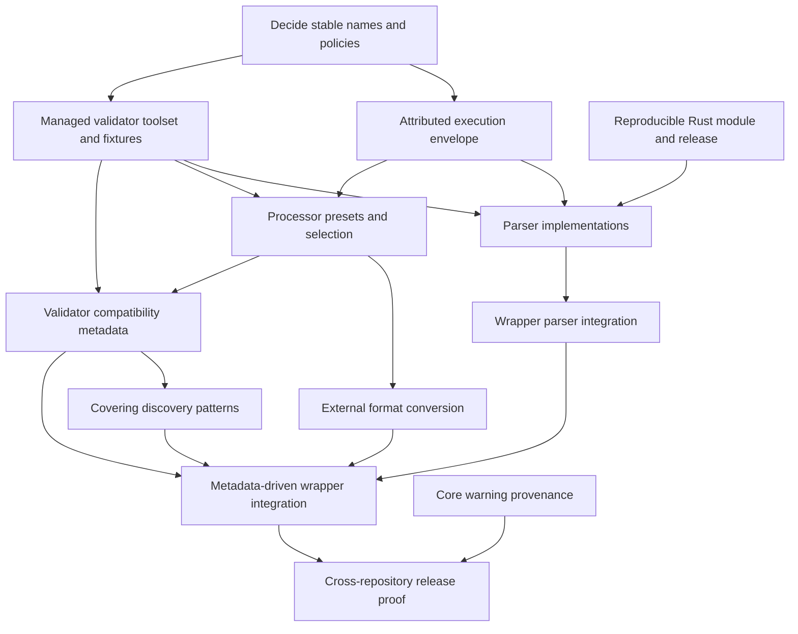

# Schepherd integration

## Goal

Complete the Schepherd, datamitsu and datamitsu-config integration without losing file attribution,
silently skipping validation, or duplicating validator-output parsers in Go and Rust. Preserve the
working offline catalog delivery while adding structured diagnostics and broader validator coverage.

This is an implementation task register, not an instruction to execute every draft recommendation.
Tasks requiring an unresolved product decision remain blocked until that decision is made.

## Recovered intent and evidence

The retained Schepherd worktree `datamitsu-integration-ideas` contains twelve concept documents under
`concepts/`. Its local `.gitignore` contains `*`: these documents are not tracked, so they are not a
durable task system. Preserve that source directory until the relevant requirements are migrated.

The strongest retained design sources are `00-overview.md`, especially its user-decisions section;
`01c-schepherd-validators-via-datamitsu.md`; `01d-schepherd-monorepo-rust.md`;
`02-schepherd-processors-and-json-output.md`; and `03c-schepherd-datamitsu-parser-plugin.md`.
The recovery session and its archived tool results in OpenViking were also inspected. The original
planning session is not directly retrievable through the current session API. Consequently, the
requirements below are recovered design intent, not new approval of every proposed flag or default.

The intended responsibilities were:

- datamitsu discovers files, installs pinned tools, binds exact dependencies, loads WASM parsers and
  presents diagnostics. It remains independent of Schepherd.
- Schepherd resolves schemas and selects configured validator processors. It provides an attributed
  execution envelope, but does not parse validator output by default.
- Sourcemeta `jsonschema` is the primary validator. `check-jsonschema` and AJV cover schemas or formats
  it cannot handle. Projects can override processor selection.
- Conversion belongs to replaceable external tools, initially `yq`, not an embedded conversion stack.
- A Rust WASM module owned and released by Schepherd parses both the Schepherd envelope and direct
  validator output. Proposed keys were `schepherd`, `jsonschema`, `check_jsonschema` and `ajv`.
- Catalog metadata records validator compatibility. Schepherd produces covering discovery globs,
  optionally filtered by validator support. The wrapper should not compile the entire catalog itself
  once equivalent upstream metadata exists.
- A catalog digest is released with datamitsu-config. Prepared schemas and notices travel in OCI
  layers, not inside the JavaScript configuration bundle.

## Recovered pre-C1 baseline: 2026-10-20

| Surface                                          | Current state                                                                                        | Evidence                                                                                            |
| ------------------------------------------------ | ---------------------------------------------------------------------------------------------------- | --------------------------------------------------------------------------------------------------- |
| Schepherd catalog preparation                    | Implemented; full catalog and notices work offline from a relocated read-only copy                   | Schepherd `internal/materialize/`, `internal/cli/materialize_cmd.go`; exercised locally             |
| datamitsu preparation and OCI delivery           | Implemented; preparation identity includes catalog arguments, ready state is restored from the store | `src/datamitsu-config/datamitsu.config.d.ts`, generated Dockerfiles and OCI maps; exercised locally |
| Wrapper runtime integration                      | Pinned Schepherd and Sourcemeta, exact dependency binding, managed configuration, offline lint       | `src/datamitsu-config/apps.ts`, `tools.ts`, `managed-configs/schepherd_toml.ts`                     |
| Catalog selection                                | Generated 1,291 positive globs; 144 schemas excluded after compilation with the pinned validator     | `scripts/pull-schepherd-catalog.ts`, `registries/schepherdCatalog.json`                             |
| Structured diagnostics                           | Missing; the operation has no `outputParser` and forwards anonymous Sourcemeta evaluation JSON       | `src/datamitsu-config/tools.ts`, real CLI output and parser recognition probes                      |
| Schepherd execution report                       | Report version 1 contains task files and exit status, not captured output or diagnostics             | Schepherd `internal/runner/report.go`, `internal/cli/run.go`                                        |
| Rust parser implementation                       | No production Rust crate or WASM module found in main or the retained local branches                 | No Cargo manifests or Rust sources; concept 03c describes only an external research prototype       |
| Additional processors and compatibility metadata | Proposed, not implemented in the inspected client and publisher                                      | Current catalog format is 2; current client explicitly rejects format 3                             |

At this pre-C1 inspection point, the installed datamitsu parser pin, npm manifest, OCI manifest,
payload hash and loaded WASM version agreed; neither published parser module provided a Schepherd or
Sourcemeta parser. The subsequent released C1 section records that gap's resolution.

### Released C1 integration: 2026-10-20

Schepherd v0.2.1 publishes report version 2, configurable processors and a separate WASM parser
module (ABI 2, capability schema 3). The wrapper now adopts the released binary and the
`schepherd` module/key together. The original catalog digest, 1,291 globs, unusable-schema list and
sole Sourcemeta validator remain unchanged.

The default `native` processor is explicitly custom with `sourcemeta-json` output, retaining the
existing validator arguments without requiring compiled-cache preparation. Typed processors,
additional validators, conversion and catalog compatibility metadata remain separate work.

Exercised through the managed tool and published OCI parser: two failing files have distinct
file/position/keyword findings; valid input emits no validator JSON; malformed input and a missing
local schema fail visibly; changing only a local schema invalidates an unchanged document on the
next run. Operation-result caching is disabled for this dependency boundary. Catalog-backed
offline checks pass from a relocated read-only source cache without its service directories and
leave its snapshot unchanged. Anonymous manifest/config/WASM retrieval matches the release hashes.

Release prerequisite found during that proof: v0.2.1 opens a compiler cache for all-local custom
processors, even though they never compile. A copied read-only source cache without `v1/locks`
therefore fails before validation. The upstream `fix/custom-processor-cache` branch now skips that
open for custom-only configurations, with regression tests for absent, non-directory and minimal
prepared cache paths. Its built CLI validates both valid and invalid local inputs against the
same read-only copy without mutation. The wrapper must adopt the published fix before C1 is
release-ready; do not substitute a development binary or claim v0.2.1 includes it.

## Working rules

- Keep repository changes separate. Do not implement Schepherd behavior in datamitsu-config as a
  workaround for an absent Schepherd contract.
- Preserve the current pinned catalog while changing client protocols; publish readers before new
  catalog writers. Never publish a catalog unreadable by the supported client.
- Keep unrelated existing checks enabled. A failed commit hook is a blocker to resolve, not bypass.
- Use current parser ABI and capability descriptors. The old concepts describe an earlier ABI and
  must not be implemented verbatim.
- For each behavior change, keep a deterministic consumer-visible regression case and exercise the
  actual CLI. Use real validator outputs, not mocks that merely echo the proposed contract.
- No release numbers in evergreen usage prose. Versions belong in executable pins and compatibility
  metadata, or in explicitly dated evidence.

## Dependency graph

Existing preparation/offline delivery remains a preserved baseline, not a prerequisite to reimplement.
The dependency graph records the original implementation order; the statuses below supersede its
early open-state assumptions.

## Task D0: settle durable public contracts

Owner: cross-repository design. Status: settled locally; downstream release sequencing remains open. Dependencies: none.

The selected public identities and behaviors are:

- Processor types are `sourcemeta`, `check-jsonschema` and `ajv`; the Sourcemeta runtime tool is the managed `jsonschema` executable. The managed defaults run in that order. Explicit project selection and order win; legacy generated runner defaults migrate to these presets, while custom runner/processor settings remain untouched.
- Processor support is not validation success. An exact, matching unsupported profile allows the next configured processor; an invalid document or operational failure does not trigger retry. Missing or stale profile identity is unknown and causes a runtime probe, never a false unsupported result.
- The check-jsonschema frontend is the upstream Python adapter, with its exact Python dependencies in one locked UV environment. The AJV frontend is the upstream AJV library adapter, with exact Bun dependencies. AJV handles JSON only. JSONC and extensionless format routing uses explicit source-format metadata and a frontend that accepts `--format`; no validator parses input code as JavaScript or treats literal paths as globs.
- Conversion is replaceable external tooling: yq is bound exactly and configured for Sourcemeta TOML conversion. Converted diagnostics do not claim original positions unless the source mapping proves them.
- Catalog v3 entries record the SHA-256 of the final bundled schema, profiles keyed by canonical processor/tool identity and settings digest, an explicit result and stable reason when unsupported, plus source-format names, extensions and filenames. The client trusts a profile only when all identities match. Catalog v2 remains readable and gets runtime probes; missing v2 metadata is not a compatibility verdict.
- Discovery uses `schepherd patterns --validators sourcemeta,check-jsonschema,ajv --covering --json`; rows preserve original `fileMatch`, including negations. The wrapper omits exact duplicate positive globs from automatic catalog selection only when each affected row records `covering.excluded` with every candidate schema ID. The default operation unions those catalog globs with JSON, JSONC, JSON5, YAML, YML and TOML globs so project-local mappings are reachable. `--safe-catalog` skips ambiguous/unknown-format automatic associations with reasons; `--ignore-unmatched` keeps unmapped files from failing. Explicit mappings/local schemas take priority and still fail on invalid documents.
- The execution envelope is report v3 over parser ABI 2/capability schema 4 (`input-skips`); report v1/v2 remain readable. Classified safe skips are preserved as non-gating, partial input coverage, not fabricated diagnostics or a clean full validation. The parser remains a separately pinned WASM module; no core-owned duplicate parser is introduced.

These decisions are implemented in local client and wrapper branches. They are not a claim that unreleased artifacts or the v3 catalog have shipped.

## Task C0: correct known wrapper selection boundaries

Owner: datamitsu-config. Status: implemented and locally exercised; release sequencing remains open. Dependencies: none; preserve current behavior elsewhere.

- Exclude Cspell JSONC configurations from strict-JSON validation while retaining their YAML forms.
- Keep automatic catalog selection conservative: duplicate positive globs are recorded with every candidate schema ID and excluded from generated auto-globs, never assigned to an arbitrary schema. Managed safe-catalog mode visibly skips ambiguous or unsupported automatic associations with a reason; the invocation records incomplete input coverage. Explicit mappings and local schemas take priority and still validate strictly.
- The default operation also includes JSON/JSONC/JSON5, YAML/YML and TOML source globs, so project-local mappings do not depend on a SchemaStore filename match. Schepherd's Windows ARM64 binary still has no matching Sourcemeta dependency target and remains excluded from advertised platforms.

Acceptance: valid commented Cspell config is not rejected; ambiguous extension/plugin manifests never select an arbitrary schema; explicit mappings validate valid documents and report invalid ones; safe skips are visible and cannot become a complete clean result; unsupported dependency targets have an explicit outcome. Preserve tests and temporary-project smoke cases for these boundaries.

## Task S1: emit an attributed Schepherd execution envelope

Owner: Schepherd. Status: shipped in v0.2.1 as report version 2; parser contract and attributable execution are in use. Dependencies: D0 for public schema and names.

Add an opt-in machine-output mode that emits one versioned document for the complete run. Include
processor identity/output format, schema identity, exact working directory, original input paths,
actual consumer paths, execution status and bounded captured stdout/stderr for each task. Preserve
plain execution and all nonzero failure outcomes. Report early matching, cache and preparation errors
as structured run-level errors, without pretending a validator ran.

File attribution is a hard prerequisite. A task containing multiple anonymous Sourcemeta results is
not enough. Establish and verify a per-evaluation identity contract, or use one input per consumer
task for formats lacking identity. Do not pair output objects to argv by position: YAML and JSONL can
emit multiple evaluations per file, and malformed inputs can abort before later files are checked.

Acceptance: mixed valid/invalid files, multiple YAML documents, malformed input, ambiguous mappings,
unknown processors, timeout, cancellation, output truncation and offline misses all produce honest,
bounded results. No error can be attributed to a neighboring file or made green by missing output.

## Task S2: manage the validator toolset and capture real fixtures

Owner: Schepherd. Status: published frontends in v0.2.1; local RC adds explicit format handling and source identity. Release of that expanded frontend protocol is pending. Dependencies: D0 for stable processor identities and AJV frontend.

Use one pinned toolset for Sourcemeta, check-jsonschema and AJV in tests and publisher probes, installed
through datamitsu. Preserve the publisher's independently pinned bundling recipe when moving its
installer. Capture real valid, invalid, parse-error and compile-error outputs across supported schema
dialects and document formats. Keep direct execution of resolved binaries where exit-code fidelity
requires it; measure the current execution contract instead of copying old assumptions.

Acceptance: no duplicated manual installer path, deterministic tool identity, isolated network-free
fixture execution, and a reproducible validator matrix. An unavailable validator is not recorded as
an unsupported schema. AJV never executes an input document as JavaScript or interprets literal file
paths as globs.

## Task R0: add reproducible Rust parser infrastructure and publication

Owner: Schepherd. Status: shipped with the v0.2.1 parser module and OCI artifact. Dependencies: none for infrastructure; D0 before public metadata.

Create the production parser crate beside the Go code, with one pinned Rust toolchain, locked
minimal dependencies and separated ABI/parse logic. Go-only development must not require Rust.
Integrate package commands with the existing task conventions. Build a module usable by the pinned
datamitsu host, and publish its verified release asset and OCI artifact with machine-readable pins.

Acceptance: native parser tests and actual WASM-host smoke pass; builds from different paths are
byte-identical and contain no developer paths; malformed/deep/truncated input cannot panic or hang;
release metadata identifies the exact payload, ABI, descriptor and supported report versions. Do not
publish an empty module merely to complete infrastructure.

## Task R1: implement the Schepherd-owned validator parser module

Owner: Schepherd. Status: shipped with the v0.2.1 parser module, ABI 2. Dependencies: R0, S1 and S2.

Implement the Schepherd envelope parser and direct parser entrypoints for the selected validators.
Share validator parsing logic rather than implementing a second copy in the Go client or the core.
Recognize all relevant output documents, suppress successful evaluations and annotations, retain
meaningful schema keywords and JSON Pointers, and use the actual coordinate unit. Preserve explicit
input/schema paths on operational errors. Unknown or truncated failing output must remain visible.
Skipped inputs are not diagnostics; incomplete validation cannot produce a cached pass.

Acceptance: real fixtures cover multiple failures, Unicode columns, Windows and unusual filenames,
multiple-document inputs, schema/parse failures, malformed envelopes, unknown formats and nonzero exit with
no diagnostics. Every reported input path is proved by the envelope or native output. The module is
loaded and exercised through the actual datamitsu parser host.

## Task S3: add configurable processor presets and selection

Owner: Schepherd. Status: implemented in the local release-candidate branch; focused processor/runtime tests pass, publication pending. Dependencies: S1, S2 and D0.

Add configured processor types for Sourcemeta, check-jsonschema and AJV, plus custom commands. Keep
exact managed binary bindings separate from processor identity. Make explicit project selection win;
automatic selection uses declared capabilities and format support, never a silent retry of a failing
validation against another validator. Schema invalidity is a result, not a reason to select a more
permissive processor.

Acceptance: explicit selection, automatic fallback, unsupported input, missing binaries and ambiguous
configuration have deterministic documented outcomes. Tests prove precedence and distinguish schema
incompatibility, invalid documents and operational failures.

## Task F1: support replaceable external format conversion

Owner: Schepherd. Status: implemented in the local release-candidate branch with yq delegation and explicit source-format routing; publication pending. Dependencies: S3 and D0 for unsupported-format policy.

Determine document format explicitly, including extensionless files and known JSONC configurations.
Delegate conversion to configured external tools, initially yq where suitable; do not embed a second
format-conversion implementation. Preserve original-to-converted path mapping and only retain source
positions when proven meaningful. Never modify source documents.

Acceptance: valid JSONC/YAML/TOML and extensionless fixtures reach a compatible validator or a visible
unsupported outcome; failed/missing converters remain failures; diagnostics point to original files,
without fabricated coordinates after transformation.

## Task V1: publish incremental validator compatibility metadata

Owner: Schepherd client and publisher. Status: v3 client reader/runtime profiles and publisher v3 output are implemented locally; real-validator and publisher profile tests pass. Publication pending. Dependencies: S2, S3 and D0.

Add client support for versioned compatibility profiles and document-format metadata before the
publisher emits it. Probe schema compilation using the pinned toolset in isolation. Reuse probe
results only when schema bytes, validator identity and relevant profile settings are unchanged.
Distinguish schema incompatibility from crashes, missing tools and infrastructure failure.

Acceptance: old pinned catalogs remain readable; a released client understands the new format before
publication; schema or validator updates trigger appropriate probes; unchanged inputs reuse results;
unsupported schemas stay visible in metadata instead of disappearing silently.

## Task G1: expose safe covering discovery patterns

Owner: Schepherd. Status: implemented in the local release-candidate client; covering globs, validator filters and v2 runtime probes are tested locally. Publication pending. Dependencies: V1 for validator-filtered behavior.

Provide covering globs for known extensions while preserving extensionless and path-specific cases.
Support an optional validator filter using catalog profiles; define union semantics and unknown IDs.
Keep per-schema negations local and retain runtime resolution. Broad discovery must be paired with a
supported runtime outcome for unmatched, unsupported and catalog-ambiguous files.

Acceptance: root/nested/dot-directory cases and unusual extensions are covered without false
negatives; filtering does not claim validation that cannot run. Output is deterministic and records
why schemas/patterns were excluded.

## Task K1: correct datamitsu feature-warning provenance

Owner: datamitsu core. Status: open. Dependencies: none.

The current loader checks inherited prepared apps against each later layer's minimum version. A root
layer forwarding the base configuration therefore receives a misleading prepare-version warning even
though the introducing base already requires a sufficient core. Attribute the feature to the layer
that introduces it, or use the chain's enforced minimum without hiding genuinely unsafe layers.

Acceptance: an inherited safe prepare declaration emits no false warning; a layer introducing prepare
with an insufficient minimum still warns. Preserve remote/local layer ordering and validation.
No Schepherd-specific core API or a new WASM ABI is required solely for the external plugin design.

## Task C1: cut over the wrapper to the published parser contract

Owner: datamitsu-config. Status: shipped against Schepherd v0.2.1 and parser ABI 2; catalog-backed offline checks and local-schema invalidation were verified. The v0.2.1 custom-only cache limitation remains only for custom-only configurations. Dependencies: published S1 and R1 artifacts.

Pin the Schepherd-owned module separately from the core parser. Adopt its machine-output mode,
processor configuration and `outputParser` together, verifying ABI/report compatibility and payload
hashes. Preserve prepared catalog delivery and project mappings. Do not route anonymous batch output
through a parser that cannot prove file identity.

Acceptance: the real `pnpm dm lint --tools schepherd` displays file/position/message diagnostics rather
than raw successful JSON and annotations. Two failing files, valid input, malformed input, early
Schepherd failure and offline execution produce correct terminal and machine reports. Unknown output
cannot become a successful cache entry.

## Task C2: adopt compatibility metadata and the selected validator set

Owner: datamitsu-config. Status: implementation and published-artifact consuming-project proof passed on Linux x64 (2026-11-10).
The native client, source frontends and independent parser pins target published Schepherd v0.3.1;
the published v2 catalog remains unchanged. Published core `0.0.0-unstable.20261110.e7b3456` supplies
Node/Bun executable bindings, UV dependency maps and structured input-skip host support.
Dependencies: C1, V1, G1, F1 and D0.

The puller requests `patterns --validators sourcemeta,check-jsonschema,ajv --covering --json`, persists covering globs and any complete v3 schema/profile metadata, and uses v2 discovery data only with runtime probes. It no longer compiles the whole catalog or carries a JSONC schema-ID list. Exact duplicate positive globs are excluded only with their `covering.excluded` candidate-ID provenance. Default operations union catalog coverage with local JSON/JSONC/JSON5/YAML/YML/TOML patterns.

The wrapper registers Sourcemeta, check-jsonschema and AJV in that order, with exact managed bindings and generated locks. Its Go check-jsonschema launcher runs the verified upstream adapter source staged from the archive with the Python interpreter in the managed UV app; AJV uses the managed Node runtime. The yq converter remains an exact external-tool binding. Project processor order, local schemas and mappings remain preserved.

Acceptance: catalog generation preserves collision provenance and the published v2 pin remains usable through runtime probes; JSONC and ambiguous filenames have sound runtime treatment; no tool is installed as a fake fallback; ordinary and air-gapped consuming projects validate with the same declared policy.

## Task E1: prove the complete release chain

Owner: all three repositories. Status: published core/Schepherd consuming-project proof passed on Linux x64 (2026-11-10); Docker/OCI image execution remains a CI gate. Dependencies: C1 and C2; K1 independently.

Exercise released or release-candidate artifacts across clean consuming projects, including nested
projects, project-local schemas, malformed/invalid/valid documents, multiple processors and copied
read-only prepared state. Verify parser and tool artifacts through normal delivery, not only local
build paths. Ensure local schema changes invalidate previous successes under the selected cache
model. Update user documentation to match actual supported behavior, not unreleased concept claims.

Acceptance: attributable findings and honest operational failures in human output, JSON reports and
CI annotations; no network on offline checks; no preparation rerun after a complete OCI restore;
passing relevant hooks/tests/builds and documented platform/runtime limits. Remove replaced wrapper
workarounds in the same migration rather than leaving compatibility shims without consumers.

Local evidence (2026-11-08; not a release claim): the fixture used the published v2 catalog digest, a hash-pinned local Schepherd CLI/source RC and the actual parser WASM SHA-256 `6ec760b38d8c65172dfd4c7a0f4b16cea188d994d1030e35c1ff83c9a7e4d7a9` (ABI 2, capability schema 4). Offline materialization completed with 997 schemas and no missing entries; the read-only snapshot hash remained `fff0173f67470b4e3f13597000318e8c28f33a439532cb7fbb61a105971c306f`. The ordinary no-map managed run exited 0 but reported both categorized skips and `complete:false` with `input-skipped`/`narrowed-selection`; an explicit mapping validated a valid manifest and reported two attributed errors for an invalid one. Root `pnpm test` with the local `DATAMITSU_BIN` core override passed 66 files/760 tests, `go test ./...` passed 52 packages, and the Rust parser suite passed 38 tests. The full cross-repository check was not green: the Go `gocritic` run panicked and the Python `ty` environment could not resolve Hatchling.

## Published Schepherd v0.3.1 verification: 2026-11-09

- Generated only the Schepherd native registry entry in a scratch registry, then downloaded and hash/extraction-verified all six platform archives. Other registry entries were not refreshed.
- Pinned the actual source archive and its observed `ovineko-schepherd-e0c1af5` root; frontend dependency versions and existing lock inputs did not change.
- Verified the published WASM payload against its SHA-256 and loaded its OCI descriptor into a clean parser cache using published core `0.0.0-unstable.20261109.b5ccf8e`.
- The released native client passes a valid local document and rejects an invalid one. The released parser produces an attributed Sourcemeta `required` diagnostic from the real report-v3 output.
- The updated configuration bundle builds, and 33 focused configuration/catalog tests pass. Removed an incidental test that duplicated archive paths, hashes and dependency constants instead of exercising behavior.
- At this checkpoint, full consuming-project initialization was blocked by the published core rejecting the AJV binding. The published-core verification below supersedes that blocker; the local-core evidence above remains historical rather than release proof.

## Published core consuming-project verification: 2026-11-10

- Installed `@datamitsu/datamitsu@0.0.0-unstable.20261110.e7b3456` from npm, removed the workspace dev-link override, and verified the selected native executable resolves from the published platform package rather than a core worktree. Core parser metadata and Docker/OCI descriptions were regenerated from that installed release.
- `task refresh`, the full `datamitsu check`, all 763 tests, TypeScript checking and the fresh-init suite passed. Fresh init exercised both automatic and layered configuration loading, reconciliation/check, and idempotent create-missing behavior in a nested project. Core 0.5.1 rejected the bundle before managed-content callbacks.
- The clean consuming project used the released Schepherd v0.3.1 client, source frontends and independent parser. Sourcemeta, check-jsonschema and AJV produced attributed findings; JSONC, multi-document YAML, TOML conversion, nested projects, malformed input and two-file attribution were exercised. GitHub annotations retained the failing file names. A changed local schema invalidated an earlier successful result.
- Extensionless JSON was validated through an explicit custom processor with `output = "sourcemeta-json"`. A mapping alone does not supply an unknown format; a custom processor without a declared output remains raw and reports an honest operational failure rather than invented diagnostics.
- A meaningful unsupported-format skip remained non-gating while marking JSON coverage incomplete; JUnit represented one skipped input rather than a passing duplicate, and JSONL completion retained the skip count.
- A copied read-only prepared catalog validated both local and catalog-backed inputs with zero requests to the rejecting HTTP proxy. Invalid and malformed inputs remained attributed; copied file metadata and the original preparation marker did not change, proving no writes or preparation rerun in this check.
- Validation covered Linux x64. Dockerfiles and OCI maps were generated, not built; multi-platform image execution remains with CI. No registry-wide refresh or project-wide reconciliation write was performed.

## Release sequence

The working-tree pins use published Schepherd v0.3.1 and core `0.0.0-unstable.20261110.e7b3456`, retaining the recorded v2 catalog. Published-core and consuming-project checks have passed as recorded above; wrapper publication and multi-platform image CI remain separate release gates.

1. Core executable bindings and UV dependency maps are available in the pinned published unstable release. Keep the existing stable minimum until a real stable release supplies those features; do not invent a stable version.
2. The client/runtime, source frontends and parser use published Schepherd v0.3.1 artifacts, not local RC sources or invented versions.
3. Publish a v3 catalog only after the client reader and publisher probe contract are released. Keep the v2 catalog pin unchanged and operational through runtime probes; v3 publication is not a prerequisite for that compatibility path.
4. Update wrapper source/binary/catalog pins from those published artifacts, generate Bun/Go/UV locks through `datamitsu config lockfile`, regenerate docs and Docker/OCI outputs, and verify the package minimum and lock identities.
5. Exercise a clean consuming project using only released artifacts: JSONC/extensionless inputs, multi-document YAML, TOML conversion, invalid and operational failures, two-file attribution, explicit AJV selection, local-schema invalidation, and offline execution after restoring the prepared catalog.

The historical local RC proof used temporary SHA-256-verified archives served from localhost. The published-core proof uses the actual npm core package and released client/frontend/parser pins; no local core override or release-candidate transport was used.

## Original implementation slice (historical)

After D0, start S1, S2 and R0 as independent tasks; then implement R1 and C1. This restores the
original ownership model and fixes the present reporting problem before broadening catalog discovery
or adding default validators. K1 and the narrowly scoped C0 defects can be handled independently.
Do not substitute a text-only cosmetic change for the structured-output deliverable.
